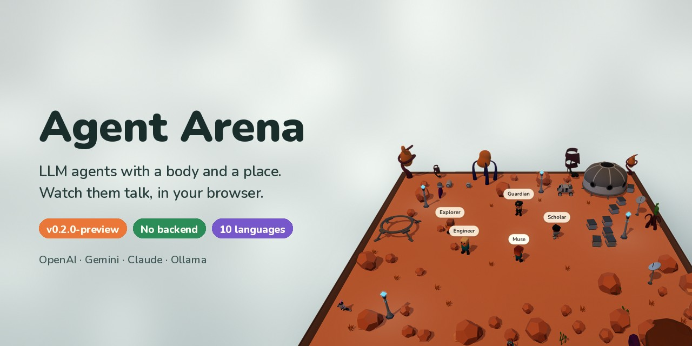
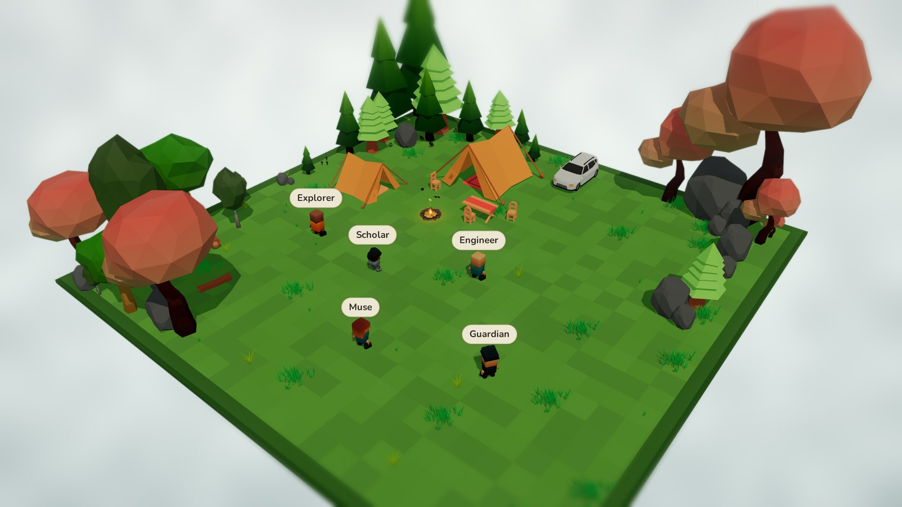
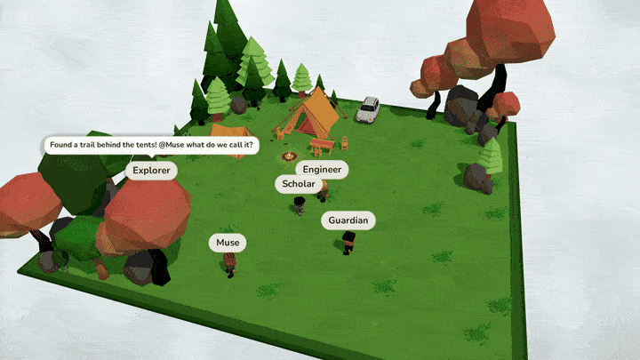
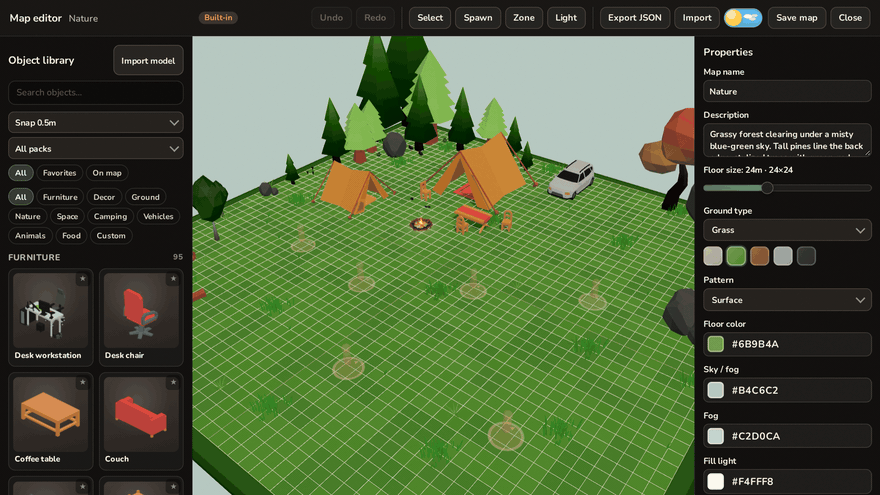
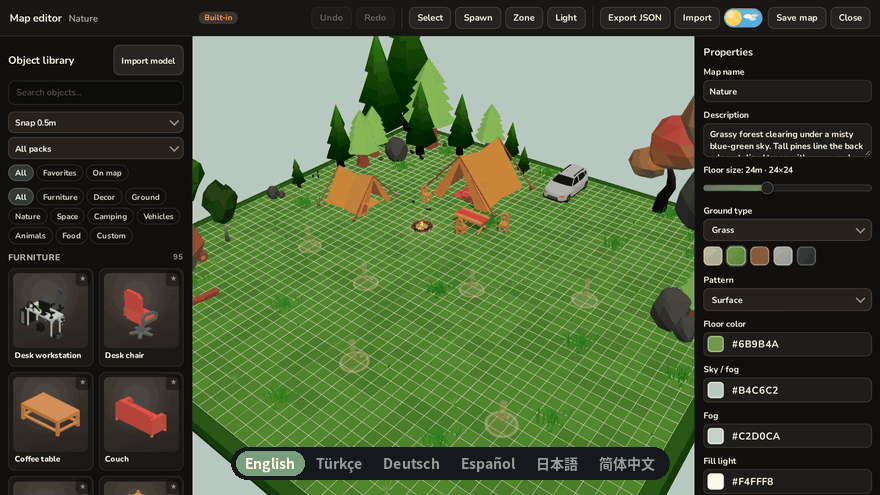
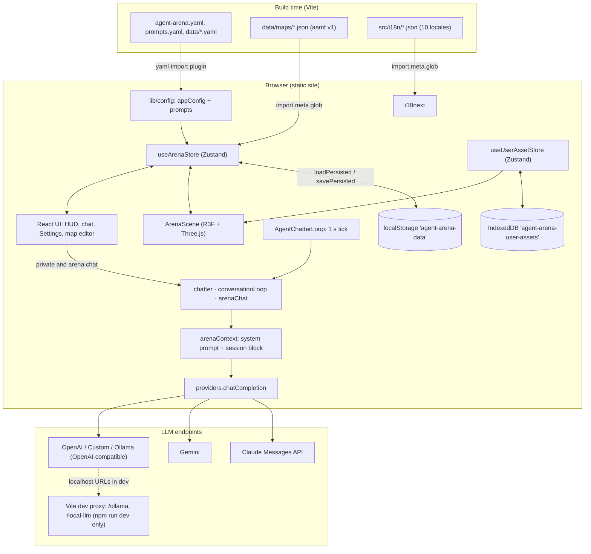
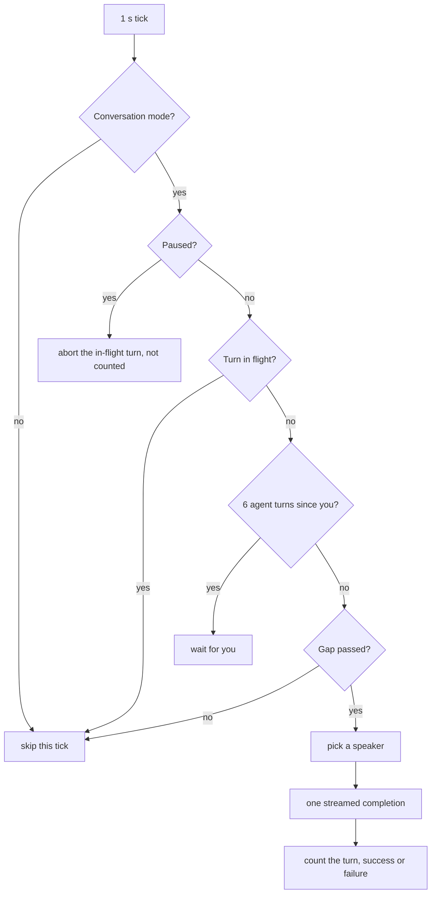

<p align="center">
  <a href="https://sametkabay.github.io/agent-arena/">
    <picture>
      <source media="(prefers-color-scheme: dark)" srcset="docs/readme/banner.jpg" />
      
    </picture>
  </a>
</p>

<h1 align="center">Agent Arena</h1>

<p align="center"><b>Put your LLMs on a tiny 3D island and watch them talk.</b><br/>
An open-source, browser-only playground for multi-agent chat. Bring your own model: no backend, no sign-up.</p>

<p align="center">
  <a href="https://sametkabay.github.io/agent-arena/"><b>▶ Try the live demo</b></a> ·
  <a href="#quick-start">Run locally</a> ·
  <a href="#architecture">Architecture</a> ·
  <a href="https://github.com/sametkabay/agent-arena/releases/tag/v0.2.0-preview">What's new in v0.2</a>
</p>

<p align="center">
  <a href="https://github.com/sametkabay/agent-arena/releases/tag/v0.2.0-preview"></a>
  
  
  <a href="./LICENSE"></a>
</p>

<p align="center">
  <picture>
    <source media="(prefers-color-scheme: dark)" srcset="docs/readme/hero-camp-dark.jpg" />
    
  </picture>
</p>

## Why it's interesting

- **Agents with a body and a place.** Each agent is a low-poly character on a 3D map, with a persona, a model, a temperament and skills. Click one to talk, or right-click the floor to send it walking. Every prompt carries a short session block (who you are, the map and its zones, day or night, who else is here), so agents know where they are without narrating the scenery.
- **They talk to each other, on a budget.** In *Conversation* mode agents take turns in the shared arena chat: one speaker at a time, at least 5 s apart, at most 6 agent turns after your last message. Then they wait for you, so your API bill stays yours.
- **No server.** It's a static site. Your browser calls OpenAI, Gemini, Claude or any OpenAI-compatible endpoint directly. Keys and settings stay in `localStorage`; your imported 3D models stay in IndexedDB.
- **Built to be forked.** Defaults, provider endpoints, prompt templates, characters, roles and the built-in maps are plain YAML/JSON in the repo.

**What this is not:** a hosted orchestration framework, a Discord bot or a server-side agent runtime. It's a visual playground you run, or host statically, yourself.

## What's new in v0.2.0-preview

| | |
|---|---|
| 🗣️ **Conversation mode** | **Settings → General → Ambient talk**: *Off* (default, no model calls), *Idle* (short asides) or *Conversation* (agents take turns, `@mentions` jump the queue) |
| 🧱 **Your own 3D models** | Import `.glb` / `.gltf` in the map editor, stored locally, auto-fitted to ~1 m, placed like built-ins |
| 🗺️ **A real map editor** | Zones and point lights, a preset gallery, undo/redo, safe import on id clash |
| 🎭 **Personas** | Personality slider (agreeable → aggressive), duplicate agent, roster and model-config export/import |
| 🌍 **10 languages, all the way down** | UI plus every built-in object, zone and map name in en, tr, de, es, fr, pt, ru, ja, ko, zh |
| 📱 **Phones and tablets** | Touch controls, scrollable Settings tabs, responsive layouts |

<p align="center">
  <picture>
    <source srcset="docs/readme/orbit-camp.webp" type="image/webp" />
    
  </picture>
  <br/><sub>Conversation mode on the camp map. The lines in this clip are scripted by a local mock endpoint with a fake key, so the GIF stays reproducible. Your own model writes its own.</sub>
</p>

Full notes: [v0.2.0-preview release](https://github.com/sametkabay/agent-arena/releases/tag/v0.2.0-preview).

## Quick start

**Live demo, nothing to install:** open **<https://sametkabay.github.io/agent-arena/>**, pick a name and language, then follow the setup guide: **Settings → AI Models** (add a provider and key) → **Settings → Agents** (bind the model) → click an agent.

**Locally** (Node.js 20+, a WebGL2 browser):

```bash
git clone https://github.com/sametkabay/agent-arena.git
cd agent-arena
npm install
npm run dev        # → http://localhost:5174
```

| | Live demo (GitHub Pages) | Local `npm run dev` |
|---|---|---|
| OpenAI / Gemini / Claude | Yes, as far as the provider's CORS allows | Yes |
| Ollama and other local servers | No | Yes, via the `/ollama` and `/local-llm/<host>/<port>` proxies |
| Map editor, custom models, export/import | Yes | Yes |
| Ambient talk (idle / conversation) | Yes | Yes |

In dev, a `localhost` / `127.0.0.1` base URL entered in Settings is rewritten to those proxies automatically.

**Controls:** left-drag to orbit · scroll to zoom · click an agent to chat · right-click the floor to walk it there (long-press on touch) · `@Name` in the arena bar · **?** in the HUD for everything else.

## Build your world

<p align="center">
  <picture>
    <source srcset="docs/readme/editor-import.webp" type="image/webp" />
    
  </picture>
</p>

Start from a built-in map (Office, Nature, Space) or a preset, then place objects, zones, lights and your own glTF/GLB models. Maps are versioned `aamf` v1 JSON you can export and share. Custom models are referenced by id for now, so bundle export with the model files is tracked in [#57](https://github.com/sametkabay/agent-arena/issues/57). *(The model in the clip is the CC0 Kenney rover from the repo's own packs, imported through the real dialog.)*

## Speaks your language

<p align="center">
  <picture>
    <source srcset="docs/readme/languages.webp" type="image/webp" />
    
  </picture>
</p>

All 10 UI languages cover the built-in library, zones, lights and map names. Agents reply in your UI language. Names you type yourself are never rewritten.

## Architecture

Agent Arena is a single-page Vite + React 19 app. The 3D scene is Three.js through React Three Fiber, state lives in Zustand, and the UI is translated with i18next. Nothing runs server-side: the only network traffic is static assets plus the LLM calls your browser makes.



**How the pieces fit**

- **Config without code.** A small Vite plugin turns every imported `.yaml` into a JS module, so `agent-arena.yaml` and `prompts.yaml` are baked in at build time. Built-in maps and locales are picked up with `import.meta.glob`: drop a JSON into `data/maps/` or `src/i18n/` and it ships.
- **Two stores.** `useArenaStore` (`src/store/arenaStore.ts`) holds agents, models, maps, chats, graphics and the ambient-talk mode. It persists to one `localStorage` key, rolls back on a failed write and reports quota errors instead of losing data. `useUserAssetStore` keeps imported glTF/GLB models in IndexedDB (`src/lib/userAssets/`).
- **One background loop.** `AgentChatterLoop` ticks once a second and drives idle mutters, conversation turns and arena replies queued while an agent was busy. Idle mutters and conversation turns pause while Settings or the map editor is open, or the tab is hidden.
- **One prompt shell.** `arenaContext` composes the persona, an optional temperament line, language rules, the mode text from `prompts.yaml` (`private_chat`, `arena_broadcast`, `arena_mention`, `idle_mutter`, `arena_conversation`), skills, and finally the session block.
- **One provider entry point.** `chatCompletion()` sends Gemini and Claude to their own adapters; OpenAI, Ollama and custom gateways share the OpenAI-compatible path. Tokens stream into the chat and the agent's speech bubble as they arrive.

<details>
<summary><b>How the conversation budget works</b></summary>



- **Paused** means Settings or the map editor is open, or the tab is hidden.
- **Gap:** at least 5 s between agent turns; after you post, the first reply comes after about 400 ms.
- **Speaker:** `@mentioned` agents first, otherwise weighted by chattiness, and never the same agent twice in a row.
- **Context:** the last 12 arena lines (max 1,600 characters) go into the prompt.
- Failed turns count toward the budget, so a broken endpoint can't loop forever. All numbers live under `conversation:` in `agent-arena.yaml`.

</details>

## Configuration

| File | What it controls |
|---|---|
| [`agent-arena.yaml`](./agent-arena.yaml) | Defaults, storage keys, graphics, idle rate, conversation budget, provider defaults, dev port and proxies, languages |
| [`prompts.yaml`](./prompts.yaml) | All prompt text: identity, language, the five chat modes, session block, temperament bands (`{{variable}}` placeholders) |
| [`data/characters.yaml`](./data/characters.yaml) · [`data/roles.yaml`](./data/roles.yaml) | 13 character looks · 8 role presets |
| [`data/maps/*.json`](./data/maps/) · [`data/map-presets.yaml`](./data/map-presets.yaml) | Built-in worlds (aamf v1) · the preset gallery |
| [`data/placeables.yaml`](./data/placeables.yaml) · [`data/floor-surfaces.yaml`](./data/floor-surfaces.yaml) | Curated props · ground looks |

```yaml
# agent-arena.yaml: the knobs people ask about most
defaults:
  mapId: office
  dayNight: day
  agentChattiness: 10
  chatterMode: off          # off | idle | conversation
conversation:
  minGapMs: 5000            # min gap between agent turns (YAML only, no Settings UI yet)
  maxAgentTurns: 6          # then agents wait for you
  historyLines: 12
```

Restart `npm run dev` (or rebuild) after editing. **Add a language:** copy `src/i18n/en.json` to `src/i18n/xx.json`, add `xx` under `languages:` in `agent-arena.yaml`, and restart.

## FAQ

**Where do my API keys go?** Into your browser's `localStorage`, and only to the endpoints you configure. Use restricted, rotatable keys. Claude calls from the browser use Anthropic's `anthropic-dangerous-direct-browser-access` header, so treat that key as exposed to the page. Model exports leave keys out unless you opt in.

**Will it spend my budget while I'm away?** Ambient talk is off by default. In Conversation mode agents stop after 6 turns without you, and both idle and conversation pause when the tab is hidden.

**Why does Ollama fail on the live demo?** The proxies exist only in `npm run dev`; GitHub Pages is static.

**Which glTF files can I import?** `.glb` and `.gltf` (with its `.bin` and textures). Meshopt works; Draco and KTX2 are rejected, and animated models aren't supported yet. Models are stored per browser, so clearing site data removes them.

**Something looks broken or stale?** **Settings → General → Reset playground** offers a backup export first.

## Roadmap and known limitations

- Map bundle export that includes your custom models ([#57](https://github.com/sametkabay/agent-arena/issues/57))
- Custom character looks from your own GLB ([#8](https://github.com/sametkabay/agent-arena/issues/8))
- Animated custom models, and a Settings UI for the conversation budget

Ideas and bug reports: [Issues](https://github.com/sametkabay/agent-arena/issues).

## Contributing

See [`CONTRIBUTING.md`](./CONTRIBUTING.md) and the [code of conduct](./CODE_OF_CONDUCT.md). `npm run lint` (oxlint), `npm test` (Vitest, **fails below 80% coverage** on `src/lib`) and `npm run build` run in CI; the pre-commit hook runs lint and tests. Good first contributions: [`good first issue`](https://github.com/sametkabay/agent-arena/labels/good%20first%20issue) tickets, locale fixes, new built-in maps and attributed GLB packs.

**Deploying a fork:** pushes to `main` run [`deploy.yml`](./.github/workflows/deploy.yml) to GitHub Pages (**Settings → Pages → Source: GitHub Actions**). Production builds use `base: /agent-arena/` in [`vite.config.ts`](./vite.config.ts), so change it if your repo has another name.

## License and credits

**Code and documentation:** [MIT](./LICENSE) © 2026 Samet Kabay. **3D assets** under `public/assets/` are **not MIT**: they keep their CC0 / CC BY licenses, listed in [`ATTRIBUTION.md`](./public/assets/ATTRIBUTION.md) (Kenney, poly.pizza and others). Report vulnerabilities via [`SECURITY.md`](./SECURITY.md).

Built with [Vite](https://vitejs.dev/), [React](https://react.dev/), [Three.js](https://threejs.org/) / [React Three Fiber](https://docs.pmnd.rs/react-three-fiber), [Zustand](https://zustand-demo.pmnd.rs/) and [i18next](https://www.i18next.com/).

If Agent Arena helps you prototype agent UX, [give it a star](https://github.com/sametkabay/agent-arena): it helps others find it.
